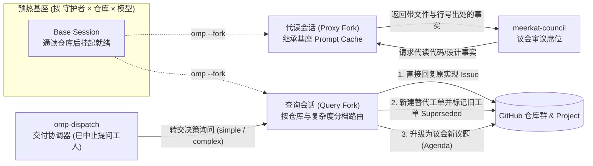

# meerkat-guardians

`meerkat-guardians` 是 [Meerkat](https://github.com/mouriya-s-lab/meerkat) 多 Agent 软件项目管理与自动交付系统中的**半有状态意图守护群**（Go 守护进程 + TypeScript `omp` 插件）。它集中承载对业务代码库、设计文档与 `omp` 工具链定制仓的深度理解，对外服务议会席位的**事实代读（Proxy Read）**与编码工人的**决策询问（Decision Ask）**。

---

## 为什么采用“半有状态”架构

在多 Agent 自治研发闭环中，议会（[`meerkat-council`](https://github.com/mouriya-s-lab/meerkat-council)）在审议议题时需要核对现有代码实现与设计规范，编码工人（`omp-dispatch`）在执行工单遇到歧义时需要请求架构或业务裁定。围绕“如何让 Agent 读懂仓库并回答问题”，常规做法面临两难：

1. **全有状态长会话的上下文退化**：若让一个常驻会话持续接收所有查询，随着翻阅的文件与问答轮次增加，上下文很快触发压缩（compact），早期建立的模块边界与代码行号认知随之模糊，后续回答的质量不可逆转地滑坡。
2. **纯无状态即读即丢的成本爆炸**：若每次查询都拉起空白会话从头搜索仓库，相同的主干代码与设计书会被反复读取成百上千次，Token 消耗与响应延迟均无法承受；而外挂向量检索库难以满足代码调用链与结构化契约的行级核对要求。

`meerkat-guardians` 以**预热基座（Base Session）+ 会话分叉（`omp --fork`）**实现半有状态复用：把高成本的“通读仓库、建立全局索引认知”收敛到一次性的基座预热会话中；此后每一次外部查询都直接从就绪基座分叉出一次性子会话——既原样继承基座上下文并命中大模型 Prompt Cache，又确保每次查询用完即毁、彼此严格隔离。

---

## 核心机制与会话生命周期



### 1. 预热基座与受控刷新（Base Sessions）

守护进程按配置中的“守护者角色 × 目标仓库 × 模型”维护独立的预热基座。基座会话在首次启动（尚无就绪会话文件）或操作员通过 [Meerkat 控制台](https://github.com/mouriya-s-lab/meerkat) 手动发起**重新预热（Rewarm）**时运行，通读目标分支后落盘就绪。

为了保证线上服务的确定性，基座**绝不因远端仓库推送而自动重刷**：
- 当远端分支出现新提交，或守护者的系统提示词、工具集、模型、`omp` 配置发生变更时，守护进程仅将该基座标记为**已过期（Stale）**并给出具体原因，供操作员在控制台择机重刷。
- 若一次重新预热中途失败或超时，之前已就绪的旧基座会话继续保留并正常服务后续分叉请求，不会造成守护能力中断。

### 2. 面向议会席位的事实代读（Proxy Reads）

议会席位自身只读议程仓库，不直接接触业务代码。当席位在起草决策表、寻找反对票反例或仲裁分类争议需要核对代码与设计事实时，向守护进程发起代读请求。

守护进程根据请求席位与目标仓库定位到对应模型的就绪基座，分叉出一次性代读会话。代读会话仅负责检索并交回带精确文件路径与行号出处的客观事实，不做主观方案表决，完成后立即销毁。

### 3. 面向编码工人的分级决策询问（Decision Asks）

编码工人在实现工单途中遇到未决问题并发起询问后，会被交付协调器当场终止，询问交由守护进程按目标仓库路由给对应的守护者，并根据询问档位（`simple` 或 `complex`）选择对应模型的基座分叉出查询会话。查询会话审阅问题与仓库现状后，通过以下三种动作之一将结论直接写回 GitHub：

1. **直接回复（Reply）**：问题在现有设计书或代码边界内已有明确答案，直接在原实现 Issue 下追加结构化回复评论。
2. **新建工单替换（Replace）**：原实现 Issue 的前提假设有误或范围需要拆改，在同一代码仓库创建附带 `omp-dispatch` 启动链接的新实现子 Issue，并将原工单关闭、状态置为已取代（`Superseded`）。
3. **升级为议会议题（Escalate）**：问题超出局部实现范畴、涉及跨模块架构或产品意图取舍，在议程仓库创建新议题并登记至 GitHub Project，交由 [`meerkat-council`](https://github.com/mouriya-s-lab/meerkat-council) 召集多席位表决。

### 4. 插件目标守持与 Prompt Cache 一致性

所有基座、代读与查询会话均在无头 RPC 模式下运行同一个 TypeScript 插件（`plugin/index.ts`），并声明完全相同的系统提示词与工具列表——仅通过环境变量区分当前会话的角色与完成条件。这一设计确保分叉会话与基座会话的前缀 Token 完全一致，从而稳定命中大模型的 Prompt Cache。在会话调用当前类型的目标工具之前，插件与守护进程会自动拦截结束事件并督促继续执行，直至目标达成或达到预设的会话超时上限。

---

## 仓库组成与公共包

本仓库除提供 `meerkat-guardians` 守护进程与 `omp` 插件外，还包含两个供 Meerkat 系列共用的基础模块：

| 路径 | 说明 |
|---|---|
| `cmd/meerkat-guardians/`、`internal/` | 意图守护群 HTTP 守护进程：管理基座生命周期、分叉调度、GitHub 未决询问恢复与多端配置预校验接口。 |
| `plugin/` | 无头 `omp` 扩展插件：注册基座就绪、事实返回、工单回复/替换/升级议题工具，并执行目标守持与 GitHub 幂等写入。 |
| `omprpc/` | **公开 Go 包**：封装无头 `omp --mode rpc` 进程通信与目标守持会话循环，同时被本仓库与 [`meerkat-council`](https://github.com/mouriya-s-lab/meerkat-council) 引用。 |
| `cmd/fake-omp/` | **确定性测试桩**：无需调用真实大模型即可按环境变量剧本模拟目标工具调用、纯文本回复、可重试/致命错误、死循环、挂起与异常退出，供单仓组件测试与验收使用。 |
| `config.example/`、`scripts/` | 本地运行示例配置（对接 `meerkat-e2e-*` 测试仓库）与 `omp` 运行目录初始化脚本。 |

---

## 本地运行与测试

运行依赖 Go、`omp`、`gh`（需已登录，通过 `GH_TOKEN` 向守护进程与插件提供 GitHub 读写权限）、`yq`（v4）以及 `~/.omp/agent/` 下已配置的模型凭据。

```sh
export GH_TOKEN=$(gh auth token)
mkdir -p /Users/mouriya/Ext/work/meerkat-guardians-local
cp -R config.example /Users/mouriya/Ext/work/meerkat-guardians-local/config
scripts/prepare-omp-dir.sh /Users/mouriya/Ext/work/meerkat-guardians-local/config
go run ./cmd/meerkat-guardians --config-root /Users/mouriya/Ext/work/meerkat-guardians-local/config
```

`scripts/prepare-omp-dir.sh` 会将配置中的 `guardians/omp/config.yml` 写入运行时 `omp` 目录，并软链本机 `~/.omp/agent/` 的模型凭据库与自定义提供商定义。

运行单测与静态检查：

```sh
go vet ./... && go test ./...
```
